<p align="center"></p>

# Memely

### Where memes become communities.

**Meme culture intelligence for Solana.**

Memely follows the path from a joke to a narrative to a community. It maps which ideas travel, keeps the original source posts beside the interpretation and places supplied Solana activity in a separate evidence layer.

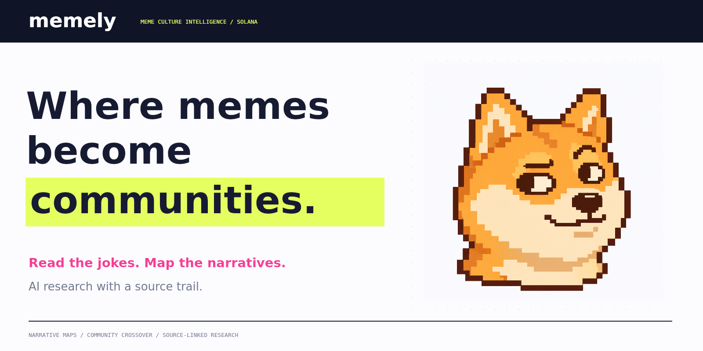

The interesting part of a meme is often what people do with it. A character gets a new role. An inside joke crosses into another room. A drawing becomes a shared ritual. Memely makes those changes readable, with a source trail that survives the summary.

| Release | Culture desk | Source edition | AI research |
|---|---|---|---|
| 0.1.0 | 12 research views | Offline HTML and modular local app | Optional Grok API interpretation and a Grok Bot role pack |

[Open the desk](QUICKSTART.md) · [Methods](METHODS.md) · [AI setup](AI-SETUP.md) · [Screenshot atlas](SCREENSHOTS.md) · [Upload guide](GITHUB-UPLOAD.md)

## Open Memely

Extract the repository and open **`Memely.html`**. It embeds the reference corpus, interface, code, styles and mascot in one file.

For the modular source edition, use Node.js 20+:

```sh
npm start
```

Open `http://127.0.0.1:4175`. Runtime, data generation, tests and the offline build need no package installation. `index.html` loads through this server; `Memely.html` also opens as a local file.

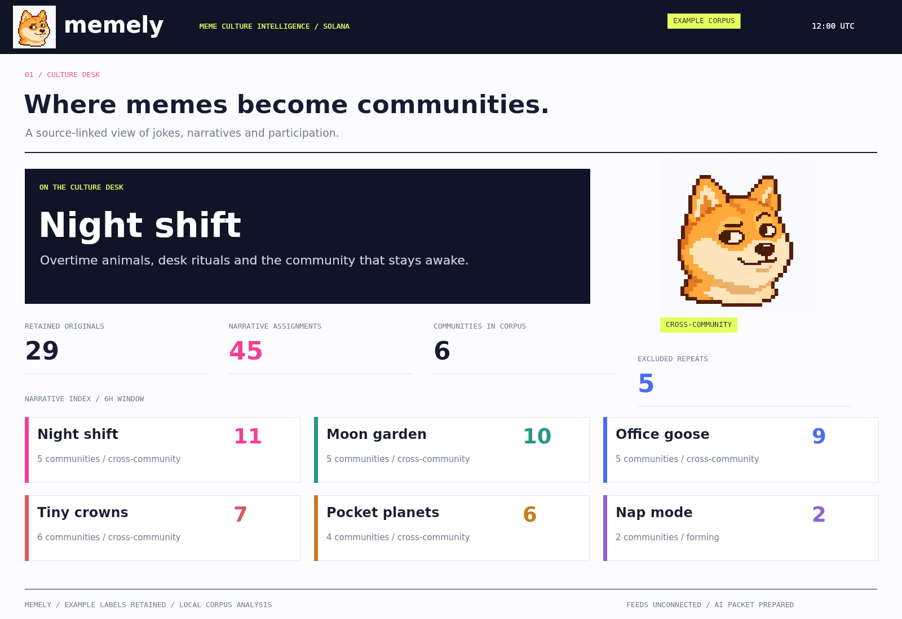

Choose a narrative, adjust the review cutoff and select an analysis window. Add a user-supplied post or import a complete corpus. Export a view, research packet, local dispatch, receipt or source corpus. The browser saves the active corpus locally when storage is available.

The supplied **reference edition** contains 52 authored source posts, six fictional community aliases, six declared themes and 23 example activity records. It includes cross-theme jokes, explicit reposts, normalised copies and a stale activity stream. These records demonstrate the methods; they are not scraped posts, real token launches or live RPC observations. Origin labels remain visible in the interface and exports.

## The narrative map

Memely's map connects themes to community aliases through retained original posts. Edge thickness follows the number of posts supporting that pair. Selecting a theme highlights its connections while keeping the rest of the corpus visible.

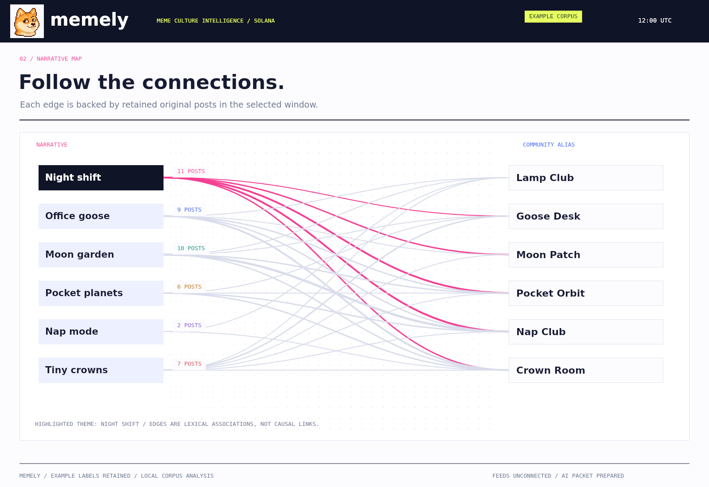

The local engine uses declared keyword phrases. It normalises text, matches complete phrases and records exactly which phrases were found. A post can belong to several themes. The map therefore represents **lexical associations in the supplied corpus**, not a discovered causal network or an embedding model's hidden interpretation.

That explicit layer gives the optional AI interpreter something concrete to read. The model can explain a cultural connection, but it cannot silently create a new source record or alter the local counts. [Narrative methods](NARRATIVES.md) define the phase labels and matching rules.

## Follow one joke through the record

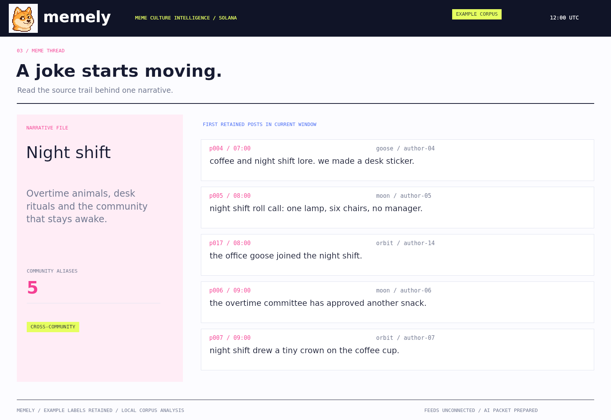

The reference Night shift theme begins with overtime animals, desk rituals and late-night community jokes. Later posts connect it with an office goose, a moon garden and little cardboard crowns. Its current-window evidence contains **11 retained originals across five community aliases**, compared with three posts in the preceding equal window.

The thread view shows the earliest retained matches in the current window, not a claimed historical origin of the meme. Every post retains its timestamp, author alias, community alias and source reference. The full packet also includes the preceding window's source posts.

## Read the sources before the summary

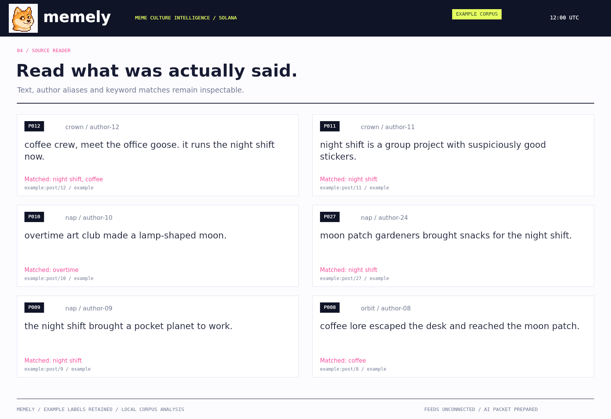

The source reader keeps the words that caused an assignment beside the assignment itself. It does not dress example text as an X screenshot or imply that an author alias has been authenticated.

Source references are opaque labels. They may name a real export row in your own corpus, but Memely does not follow them, fetch a profile or authenticate a person merely because a string exists. Author and community counts are counts of supplied aliases. [Source discipline](SOURCES-AND-SCOPE.md) explains those distinctions.

## Compare equal attention windows

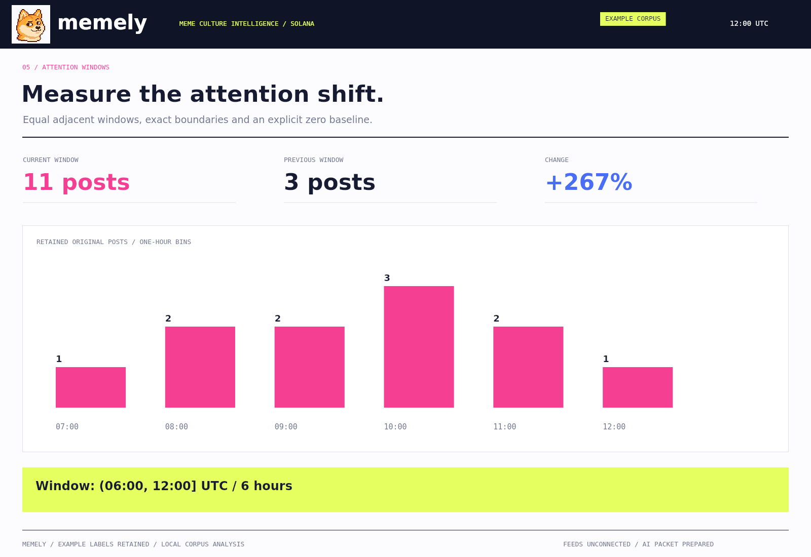

The default window is six hours. At the reference cutoff of 12:00 UTC on 2 November 2026, the current interval is **(06:00, 12:00]** and the preceding interval is **(00:00, 06:00]**. Starts are excluded; ends are included.

| Night shift measurement | Result |
|---|---:|
| Current retained originals | 11 |
| Previous retained originals | 3 |
| Absolute change | +8 |
| Community aliases reached in current window | 5 |
| Declared local phase | cross-community |

Percentage growth is only calculated when the prior count is nonzero. A zero prior count produces a null percentage and a new-baseline label. One-hour bins sum to the selected theme count. These are attention measurements, not return forecasts or market-quality scores.

## See where a theme crosses over

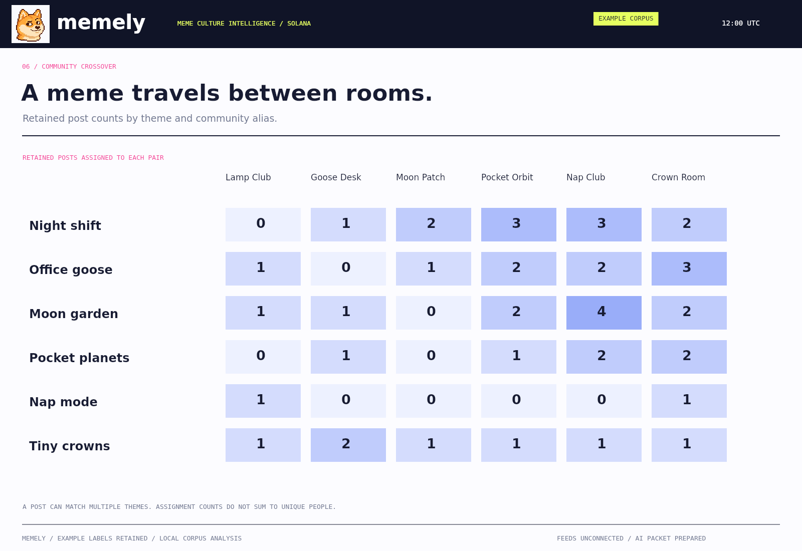

The crossover matrix gives the same map a tabular form. Each cell is the number of retained original posts assigned to that theme/community pair. Multiple theme assignments are allowed, so the default corpus has **29 distinct current originals and 45 theme assignments**.

Those denominators answer different questions. Summing theme assignments does not produce unique authors, independent people or a total market audience. The supplied community labels do not prove separate ownership or social independence.

## Put Solana activity alongside attention

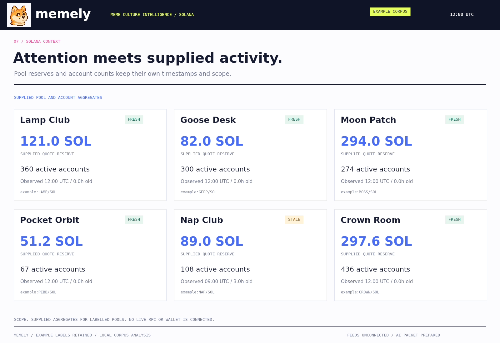

Memely accepts timestamped aggregate records for a labelled community/pool: quote reserve in SOL, supplied active-account count, source reference and origin. It selects the latest record at or before the review cutoff and the latest baseline at or before the start of the current window.

The reference Nap Club stream ends at 09:00 UTC. At 12:00 it is three hours old against a two-hour freshness budget. The old values remain visible, but their account and reserve changes are withheld. Missing baselines also withhold changes rather than using zero.

The shipped browser does not connect to a wallet, exchange, social account or RPC endpoint. Its activity layer reads supplied records. A real importer must define its pool identity, quote asset, account-count window and source coverage. [Activity contracts](SOLANA-CONTEXT.md) describe the input boundary.

## Two lenses, separate meanings

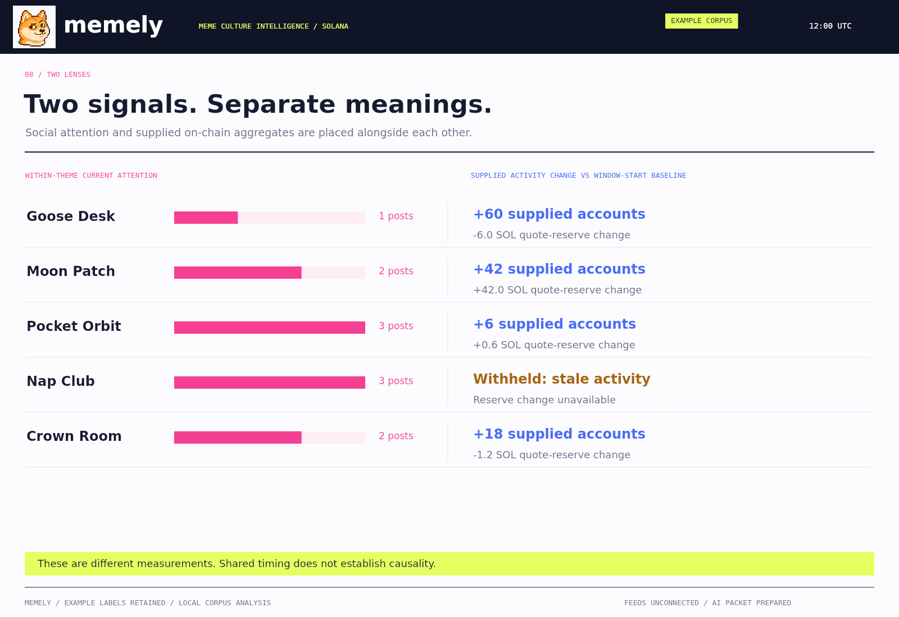

A theme can receive more posts while one labelled pool's reserve declines. A supplied active-account count can grow without establishing unique community membership. The two-lens view keeps these observations alongside each other with their own units and missing-data states.

Shared timing does not establish that one caused the other. Memely does not turn a meme phrase into a verified mint association, claim price impact or merge everything into a bullishness score. The value is the inspectable research question: what changed, where, according to which sources?

## Keep repeats out of the original count

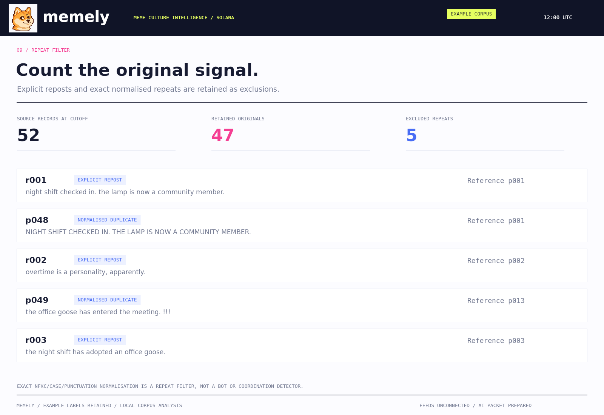

At the reference cutoff, 52 source records become 47 retained originals plus five exclusions: three explicit reposts and two normalised copies. Normalisation applies Unicode NFKC, lowercase conversion, URL removal, punctuation separation and whitespace collapse.

The earliest eligible original with the same normalised body is retained. Record ID breaks a timestamp tie. Dedupe occurs across all eligible history before either window is counted, so a later copy does not become a new original just because its first source is outside the current window.

This is an exact repeat filter. It does not identify bots, coordinated groups, semantic paraphrases or independent humans. [Curation](CURATION.md) documents the precise scope.

## AI interpretation with a bounded source packet

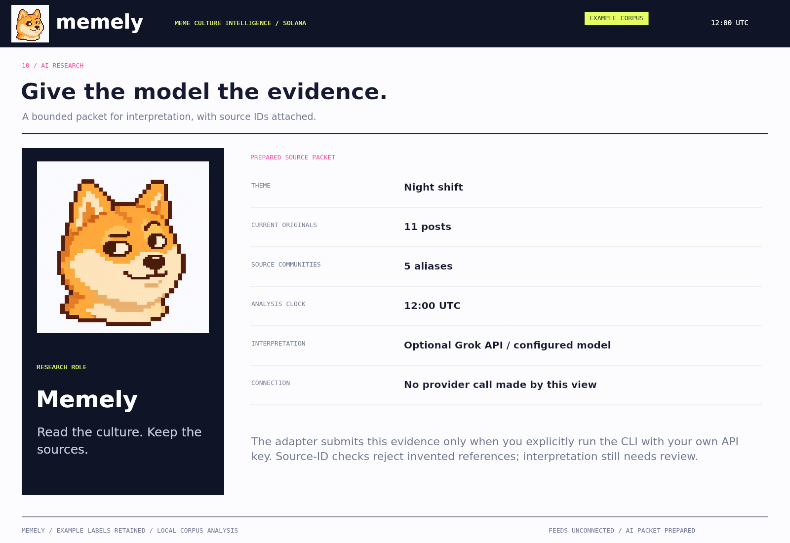

Memely has two separate layers:

1. **Local measurements:** deterministic matching, dedupe, windows, source-backed edges and activity joins.
2. **Optional AI interpretation:** a Grok request that reads the resulting packet and returns a source-cited cultural interpretation.

The CLI adapter targets xAI's Responses endpoint. It requires your own `XAI_API_KEY` and a `MEMELY_MODEL` identifier available in your account. No model is silently selected and no paid request is made by opening a view.

```sh
node ai-cli.mjs reference-corpus.json night-shift local-ai-research.json
```

Set the environment variables locally first; see [AI setup](AI-SETUP.md) for shell examples. The request separates instructions from untrusted evidence, uses `store: false`, bounds output length and rejects evidence packets above 150,000 characters.

Returned observations must cite current or prior post IDs, or supplied current/baseline activity IDs. Unknown citations and malformed output are rejected. Valid citations establish reference membership, not semantic correctness: the interpretation remains a model-authored draft for review.

The adapter is covered by mocked request/response tests. No credentialed live inference was performed to prepare this release, and the screenshots do not invent a completed model response. A [Grok Bot operator role](GROKBOT-OPERATOR.md) also supports a user-managed file handoff without API integration.

## A dispatch you can inspect

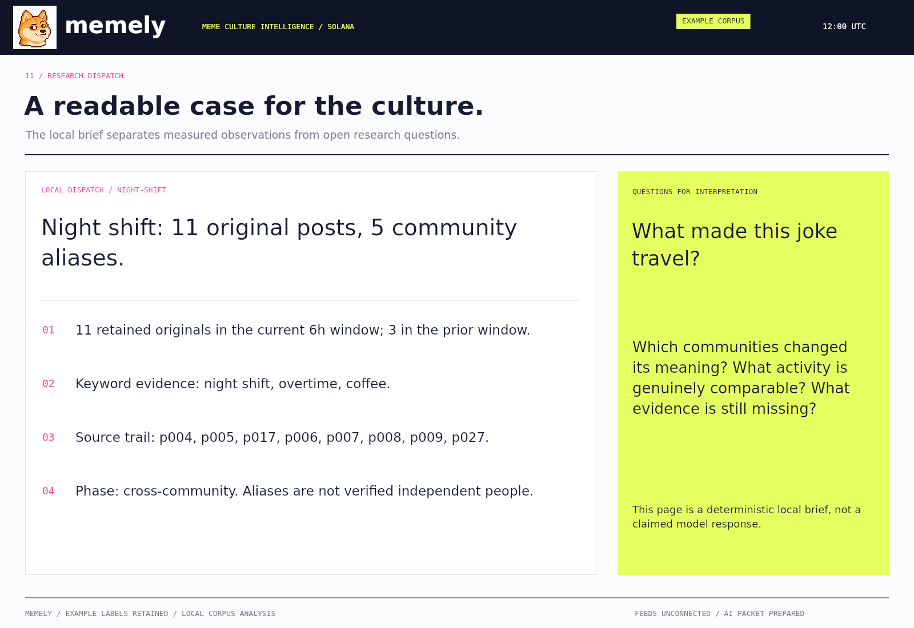

The local dispatch is available without an AI account. It reports the theme's measurements, source posts and adjacent activity context. It labels itself as deterministic local output.

```sh
node cli.mjs brief reference-corpus.json night-shift
node cli.mjs packet reference-corpus.json night-shift
```

Use that file as the starting point for human or configured AI research. The source corpus stays separate from any later interpretation. A generated summary is not written back as a source post automatically.

## Export the evidence bytes

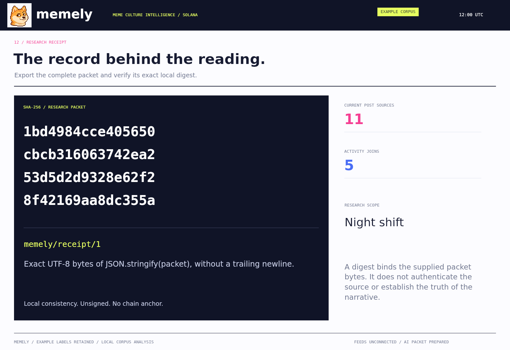

Receipts include the full research packet and SHA-256 digest of the exact UTF-8 bytes of `JSON.stringify(packet)`, without a trailing newline. This is order-sensitive encoding, not a general canonical-JSON scheme.

```sh
node cli.mjs verify reference-receipt.json
```

The digest checks the supplied packet's consistency. It does not authenticate an author, verify an observation or create a blockchain anchor. [Receipts](RECEIPTS.md) define the boundary.

## Reproduce the desk

```sh
npm run data
npm run build
npm test
npm run check
npm run integrity
```

The prepared release uses Node.js 24.22.1 and targets Node.js 20+. The local source pipeline and browser use standard JavaScript APIs. PNG regeneration additionally needs an optional native Canvas renderer and local DejaVu fonts. [Reproducibility](REPRODUCIBILITY.md).

The twelve numerical views are rendered directly from the same drawing functions used in the local app. They are application-generated figures, not images of X, a provider application or a claimed live feed. The Shiba mascot is separately generated original artwork in the familiar Doge meme direction; [provenance](PROVENANCE.md) records its final prompt and generation mode.

## One folder, complete upload

Every file is at the repository root. All twelve numbered PNGs, `memely.png` and `memely-cover.png` sit beside `README.md`. Extract the ZIP, open the inner **memely** folder and upload every file inside it. [Upload guide](GITHUB-UPLOAD.md).

| Files | Responsibility |
|---|---|
| `corpus.mjs` | Validation, text normalisation, source curation and phrase matches |
| `analyse.mjs` | Time windows, map edges, phases, matrix and activity joins |
| `research.mjs` | Source packets, local briefs, receipts and citation checks |
| `ai-adapter.mjs`, `ai-cli.mjs` | Explicit optional model request and returned research |
| `draw.mjs`, `screens.mjs` | Twelve newsroom compositions |
| `app.mjs`, `index.html`, `style.css` | Controls, text alternatives, storage and exports |
| `Memely.html` | Self-contained offline edition |
| `reference-*` | Full example corpus and derived research artifacts |
| `*.test.mjs` | Curation, timing, joins, API contract and interface checks |
| Uppercase Markdown files | Methods, AI setup, scope, privacy and contribution guidance |

Original Memely code, documentation and supplied artwork. [MIT license](LICENSE). [Roadmap](ROADMAP.md) · [Primary references](REFERENCES.md).
